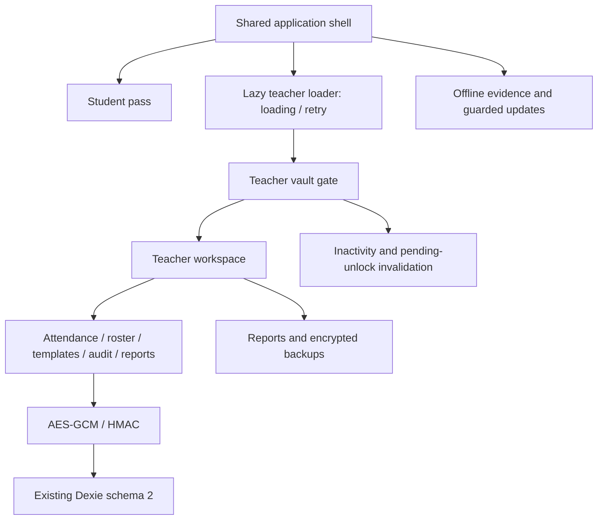

# 02 — Proposed architecture

Retain the static application and its existing domain/persistence boundaries. Introduce improvements at the UI and lifecycle boundaries; no database or cryptographic migration is required.

## Decisions

- Keep local keys in teacher state; unmounting the teacher subtree drops its references and camera effects.
- Separate loading state from authentication. Loading teacher code grants no data access.
- Use URL fragments for direct role entry and browser navigation. Retry reloads `#teacher`, recovering failed ES-module imports without deleting storage.
- Extract inactivity policy into a small hook with absolute expiry checks and lifecycle cleanup.
- Keep optional browser capabilities out of the scanner's critical startup path.
- Use a shared pagination control for bounded attendance/audit rendering, with filtering before paging.
- Keep template settings and session credentials separate; generation buttons edit the draft only.
- Preserve explicit session creation, import approval, correction reasons, template deletion and restore confirmations.
- Retain dynamic spreadsheet/decoder imports, bundled English, and production precaching of lazy chunks.
- Add browser policy restrictions without changing encryption settings or stored structures.

Avoid a framework replacement or large domain rewrite: existing transaction and compatibility regressions provide a stronger foundation than replacing working storage code. An API, cloud database and institutional identity service remain outside this implementation.
