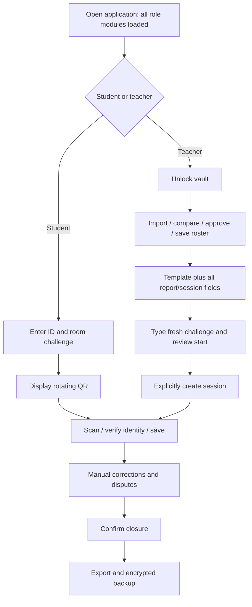
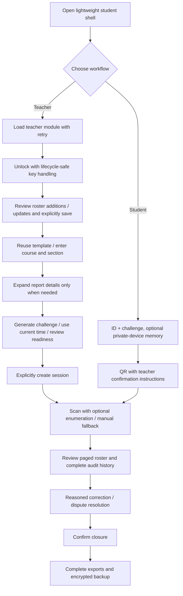

# 04 — Workflow analysis

## AS-IS

## TO-BE

## Preserved checks

Roster changes still require explicit review and identity approvals. Challenge generation does not create a session. Optional report fields retain entered/template values. Corrections and dispute resolutions retain reasons/audit. Closure, deletion and restore retain confirmations. Pagination never filters exported data. Backup observations remain advisory, not proof a file is safely stored.
